# Arta architecture

Arta runs local inference for three callers of the same Rust library. A one-shot prompt binds one agent to a model. An interactive conversation adds a controller that remembers completed turns. A workflow executes a tree of agent visits, keeping a separate conversation for each node. All three reach the selected provider for a reply or tool request. [Binary entry point](src/main.rs) · [Library entry point](src/lib.rs)

## Reading paths

| To understand… | Follow these sections in order |
| --- | --- |
| How an invocation becomes a reply | [System map](#system-map) → [Startup and configuration](#startup-and-configuration) → [One-shot and framed streams](#one-shot-and-framed-streams) → [Token generation](#token-generation) |
| Who owns a model or a conversation | [Runtime ownership](#runtime-ownership) → [Model loading and eviction](#model-loading-and-eviction) → [Workflow model selection](#workflow-model-selection) |
| What happens after pressing Enter | [Conversation commands and mentions](#conversation-commands-and-mentions) → [Terminal interfaces](#terminal-interfaces) → [Prompt construction](#prompt-construction) |
| How a model acts through tools | [Tool discovery and visibility](#tool-discovery-and-visibility) → [Tool inference and dispatch](#tool-inference-and-dispatch) → [Loop decisions](#loop-decisions) |
| How a workflow runs | [Workflow definitions and execution](#workflow-definitions-and-execution) → [Loop decisions](#loop-decisions) → [Workflow events and cleanup](#workflow-events-and-cleanup) → [Worked execution trace](#worked-execution-trace) |
| Where a setting or dependency enters inference | [Startup and configuration](#startup-and-configuration) → [Model loading and eviction](#model-loading-and-eviction) → [Sampling and output boundaries](#sampling-and-output-boundaries) → [Native dependency map](#native-dependency-map) |
| Where to check a behavior in code | [Source and test index](#source-and-test-index) |

## System map

Arrows in this view follow requests or data toward their consumer. The workflow executor lives in the library, so a Rust caller can use it without starting a CLI session.

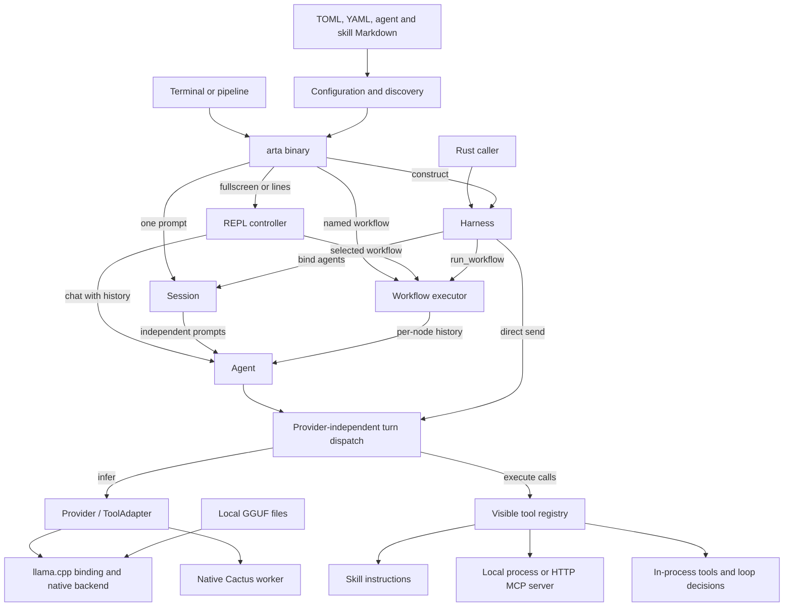

The executable owns argument handling, the REPL, terminal drawing, and output formatting. The library owns the model and tool contracts, MCP transport, skills, and workflow execution. The application registers `llama.cpp` and `cactus`. Tests and Rust clients can supply other implementations. [Provider contract](src/provider.rs) · [Factory registry](src/provider/registry.rs) · [llama.cpp registration](src/provider/llama_cpp.rs) · [Cactus registration](src/provider/cactus.rs)

## Startup and configuration

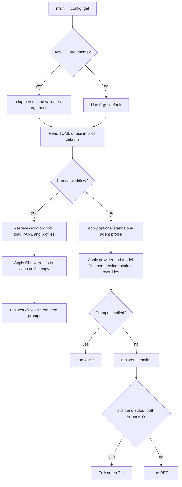

`config::get` holds the first result, including an initialization error, in a process-wide `LazyLock`. A missing implicit `config.toml` uses defaults. Failure to read an explicitly requested file is an error. The default IDs are `llama.cpp/local`; a model file still needs configuration or a path override. Bare invocation bypasses clap's prompt requirement. With arguments, clap requires a prompt unless `--agent` or `--config` permits interactive startup. `--workflow` requires a prompt and conflicts with `--agent`. [Argument parsing and configuration](src/config.rs#L127)

| Input | Resolution and precedence |
| --- | --- |
| TOML | App selects provider and model. Provider tables remain raw until deserialized by a factory. Model and shard paths, template files, skill roots, and the workflow root resolve from the TOML directory. |
| Standalone profile | Read `~/.arta/agents/NAME.md`. The filename stem identifies the agent. YAML supplies the provider and existing workspace, can replace the model and llama settings, and names configured MCP servers. The Markdown body supplies the system prompt. |
| Workflow profile | Read the referenced `NAME.md` beside `workflow.yaml`. Each distinct profile gets a clone of the base configuration. For CLI workflow runs, the same CLI overrides apply to each clone after its profile. |
| Profile paths | Resolve `workspace` and YAML `model_path` from the profile directory, expanding a leading `~` component. The workspace is the working directory for local MCP children. |
| CLI overrides | Provider and model selection happen before llama-specific overrides. A CLI `--model` or `--workflow-path` is resolved from the process working directory. Replacing a base GGUF clears its old shard list. |
| MCP executables | A bare program name uses normal executable lookup. Multi-component paths resolve from the TOML directory even when the child runs in another workspace. |

Agents and skills share a fence parser. It accepts a UTF-8 byte-order mark and LF or CRLF, deserializes only the YAML header, and preserves the Markdown body. An agent with a whitespace-only body supplies no system prompt. Profile validation rejects references to unknown MCP servers before a child is launched. [Profile loader](src/config/agent.rs) · [Front matter](src/front_matter.rs) · [llama.cpp overrides](src/provider/llama_cpp/config.rs) · [Example configuration](config.example.toml)

## Runtime ownership

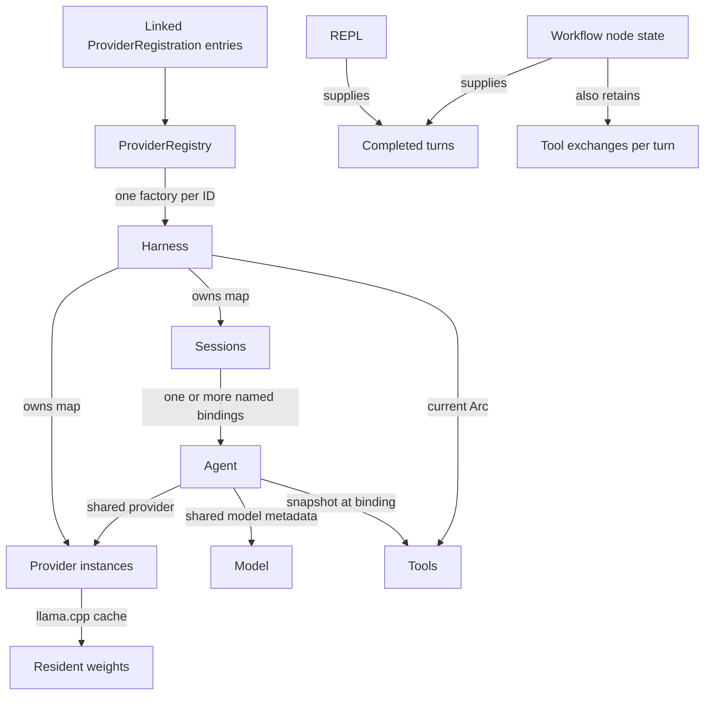

`Harness::with_registry` rejects provider tables with no registered factory, then invokes **every** factory in registry order. Constructing the llama.cpp provider registers its configured model IDs. Loading weights happens when a model is requested. The CLI explicitly loads the startup model, discovers skills, connects configured MCP servers, then creates session `cli` so its agent sees the populated registry. A workflow CLI invocation creates the harness and discovers skills up front, then loads models and profile-selected MCP tools on node visits. [Harness](src/harness.rs) · [CLI setup](src/main.rs)

Session IDs must be nonblank and unique in the harness. Agent IDs must be nonblank and unique within their nonempty session. The harness builds all bindings before inserting the session. Registering another tool uses copy-on-write, so existing bindings retain their tool snapshot. MCP discovery stages changes in a temporary registry before publishing the discovered groups. Closing a session drops its agents. The harness still owns its provider instances. [Session](src/session.rs) · [Agent](src/agent.rs) · [Tool registry](src/tool.rs)

| Library entry point | State supplied by the caller | Result |
| --- | --- | --- |
| `Harness::send` | Provider/model IDs, prompt. Uses the harness's current tools. | Collected reply text |
| `Session::stream` / `Agent::prompt` | Framed independent prompts or one prompt. Uses the bound agent's options and tools. | Framed replies or one chunked message |
| `Agent::chat` | Chronological completed turns and new prompt, plus the bound tool snapshot. | One chunked message |
| `Agent::chat_with_context_observed` | History, extra system instructions, explicit visible handles, optional rendered-prompt observer. Used by the REPL. | One chunked message |
| `Harness::run_workflow` / `Workflow::run` / `Workflow::events` | Definition or lookup name and original request. Execution creates new per-node state. | Last node's reply or a live event stream |

A provider must implement model lookup and single-prompt inference. The default chat implementation delegates an empty history to `send`. Nonempty history, system instructions, tool use, runtime model switching, and per-profile reconfiguration require the corresponding provider support. A model handle exposes its provider-local ID and trained context length. [Provider defaults](src/provider.rs) · [Model interface](src/model.rs) · [Workflow execution](#workflow-definitions-and-execution)

The Cactus provider registers model IDs and starts Arta in native worker mode on demand. The runtime module owns the child process and its JSON protocol. A tool turn owns one worker so the engine can interpret each result in the same conversation. The vendored `cactus-rs` crate handles model loading and grounding, and `cactus-sys` loads the shared C API. The Needle module maps completions to Arta's tools and extraction output. Dropping the turn terminates the worker, releasing its process-global model, and Arta's tool loop retains dispatch and the call budget. [Cactus provider](src/provider/cactus.rs) · [Worker transport](src/provider/cactus/runtime.rs) · [Vendored bindings](vendor/cactus/ARTA.md) · [Tool loop](src/provider/tool.rs)

## One-shot and framed streams

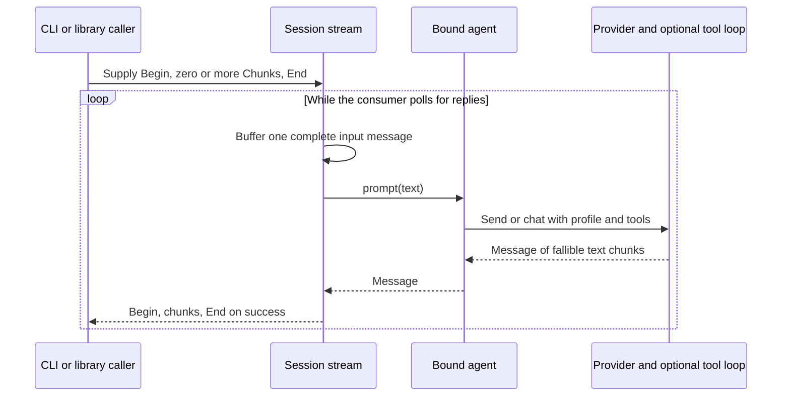

A literal `--prompt` must contain nonwhitespace. With `--prompt -`, the CLI reads through the first nonblank line **before opening the model**, preserves that prefix, and defers remaining lines until the message is consumed. A workflow collects the entire request before running. One-shot chat sends a framed message through `Session::stream`. That reader rejects a missing begin, nested begin, and EOF inside a message before calling the agent. EOF between messages completes normally. [Input and output](src/main.rs) · [Framing](src/stream.rs) · [Session reader](src/session.rs#L77)

Replies are pulled in order. A chunk error terminates the frame stream and suppresses the successful end marker. Dropping the reply stream drops its input and active reply. Terminal stdout buffers Markdown to format across chunk boundaries, including partial content on error. A pipe receives original chunks as they arrive, with a final newline on a successful reply when needed. [Markdown formatting](src/markdown.rs) · [Stream behavior tests](tests/model_selection.rs) · [CLI process tests](tests/cli.rs)

## Conversation commands and mentions

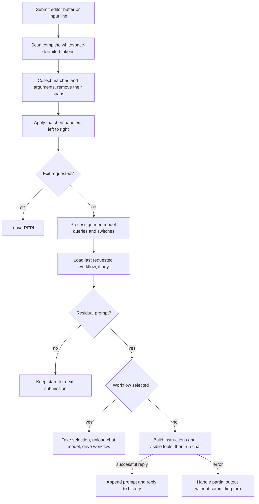

The parser takes the first registered rule matching each token. A command that takes an argument can consume a quoted value followed by whitespace or end-of-input, or a single unquoted token that does not match another rule. Other text, including unknown command-like tokens, remains available as a prompt. With no matches a nonblank input is preserved verbatim. A matching submission trims the residual prompt. Completions use the prefix before the cursor, sort by name, and replace the whole token, including any suffix after the cursor. [Parser](src/repl/parser.rs#L101) · [Suggestions](src/repl/suggestion.rs)

| Input | Effect and lifetime |
| --- | --- |
| [`/model [ID]`](src/repl/command/model.rs) | Queue a query or switch on the current provider. The frontend processes queued requests before inference and shows the last status. The agent replaces its selected metadata only after a successful switch. History survives. |
| [`/workflow NAME`](src/repl/command/workflow.rs) | Queue workflow selection. A successfully loaded definition occupies one pending slot until a prompt consumes it or reset clears it. A same-line prompt runs it immediately. |
| [`/reset`](src/repl/command/reset.rs) | Clear ordinary history, active skills, mentioned servers, and the pending workflow during parsing. The TUI also clears workflow transcripts and input captures. Profile instructions, model selection, and profile-selected MCP tools survive. |
| [`/exit`](src/repl/command/exit.rs) | Flag exit and consume the prompt. Frontends check exit before executing deferred requests. |
| [`$skill`](src/repl/skill.rs) | Append the named skill once to the active list. Its body becomes part of the system instructions in activation order. Rebuild the activation tool to list the remaining skills. |
| [`@server`](src/repl/mcp.rs) | Add the already discovered server handles by tool name. Repeated mentions reuse the entries. |

Command handlers and mentions run during parsing. Model and workflow requests take effect after parsing, in the order shown above. For example, `/reset Explain gravity` clears the conversation before sending the remaining text. An inference error leaves previously completed turns available. The UI can display an incomplete turn without feeding it back to the model. [Command registration](src/repl/command.rs) · [Conversation controller](src/repl.rs) · [Model cache behavior](#model-loading-and-eviction)

## Terminal interfaces

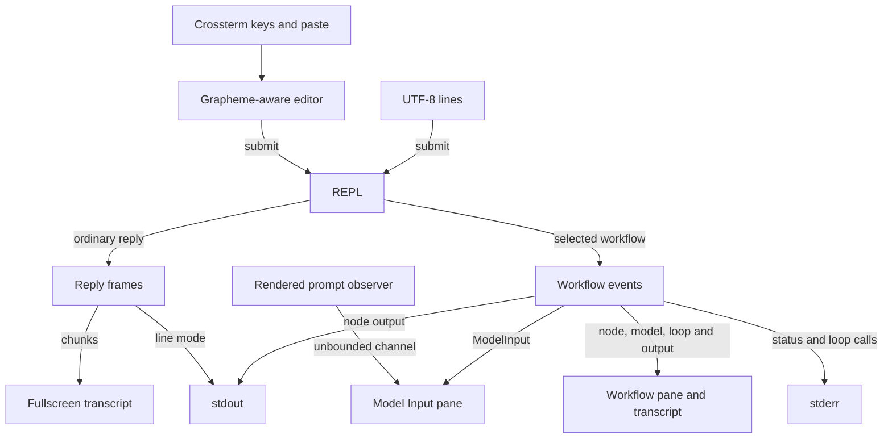

**Fullscreen.** A guard enters raw mode and the alternate screen, enables bracketed paste when supported, and attempts restoration on drop. The editor stores a byte offset at an extended grapheme boundary and computes visible cursor position in terminal columns. Paste replaces control characters with spaces. During generation, the UI selects among keyboard events, reply frames or workflow events, and a 33 ms refresh timer. Ordinary chat also receives rendered prompts through an observer channel. New chunks mark the transcript dirty. Status changes and captured inputs can draw immediately. Quitting drops the active stream. [TUI and editor](src/tui.rs#L395)

The Model Input pane keeps each inference step for the current chat turn or current workflow node. It follows new inputs only if the user was already viewing the latest. The workflow pane flattens the definition for display and marks the active row and enclosing iterations. Its transcript retains each actual visit, control call and partial reply at the ordinary history index where the workflow started. A completed workflow is therefore visible between chat turns without becoming ordinary chat context. Markdown rendering cleans terminal controls after parsing styled spans. [Workflow views](src/tui/workflow.rs) · [Terminal Markdown](src/markdown.rs)

**Line mode.** The controller reads one line until EOF or exit. With terminal stdin it writes prompts and recoverable error messages to stderr and continues. With redirected stdin, model-selection, workflow, and inference failures propagate to the process. Ordinary replies share the one-shot stdout formatter. Workflow output uses a dedicated sink that flushes node text as it arrives and separates progress onto stderr. [Line controller](src/repl.rs) · [Workflow output](src/workflow_output.rs) · [Workflow events](#workflow-events-and-cleanup)

## Tool discovery and visibility

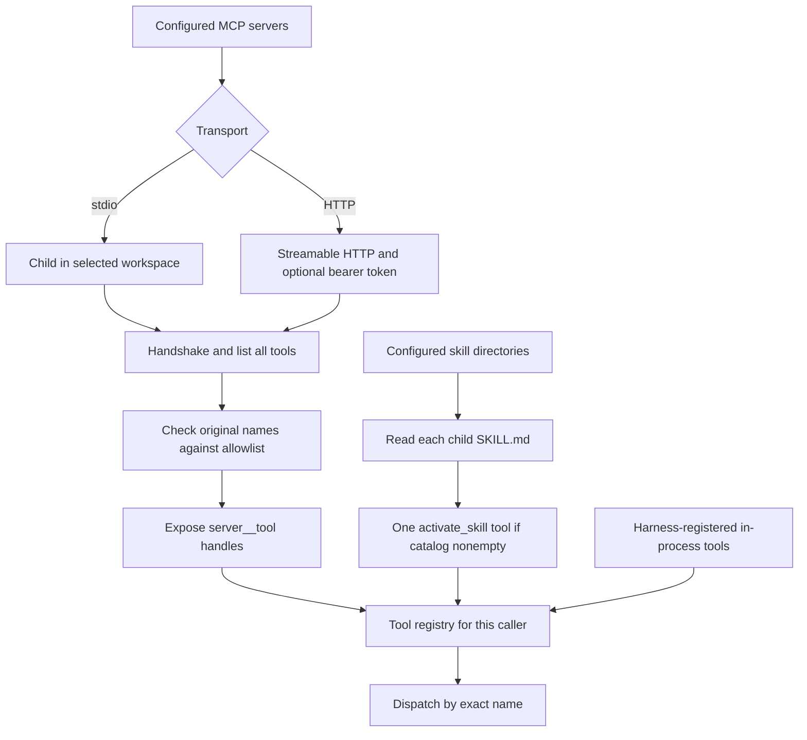

MCP connection and discovery share a 30-second timeout per server. A stdio child inherits the environment with configured overrides, has stderr suppressed, and requests kill-on-drop. HTTP can read a required nonempty bearer token from the named environment variable. Every configured tool must be advertised. An omitted allowlist selects all tools and an empty one exposes none. Exported names consist of the server name, two underscores, and the remote tool name with periods replaced by underscores. The registry rejects invalid names or collisions after normalization. Calls use the original remote name and a 60-second timeout. Structured output wins over content blocks. Otherwise text blocks are joined with newlines, with a placeholder for non-text blocks. [MCP implementation](src/mcp.rs#L128) · [Common tool contract](src/tool.rs)

Skill discovery scans immediate child directories, skips children missing `SKILL.md`, validates names and nonblank descriptions, and rejects duplicate names across roots. `activate_skill` enumerates skill names in its argument schema and returns the requested Markdown body as a tool result. Direct REPL activation inserts that body into future turns' system instructions. [Catalog and activation tool](src/skill.rs) · [REPL skill selection](src/repl/skill.rs)

| Caller | Tools offered to inference |
| --- | --- |
| CLI one-shot | Agent's snapshot of every registered tool, including all startup-discovered MCP tools allowed by each server config and the activation tool if present. |
| Ordinary REPL turn | Explicitly selected MCP tools from profile and mentions, plus the activation tool for any remaining skills. |
| Workflow node visit | Harness tools excluding previously connected harness MCP handles, plus the profile's selected servers. The run caches connections by **(workspace, server name)**. Only a deciding visit gets the loop controls. |
| Rust callers | Direct sends use the harness registry. Bound agents use their snapshot. Context-aware chat accepts the caller's explicit tool handles. |

[Harness registration](src/harness.rs) · [REPL visibility](src/repl/mcp.rs) · [Workflow tool selection](src/workflow.rs) · [Tool dispatch](#tool-inference-and-dispatch)

## Tool inference and dispatch

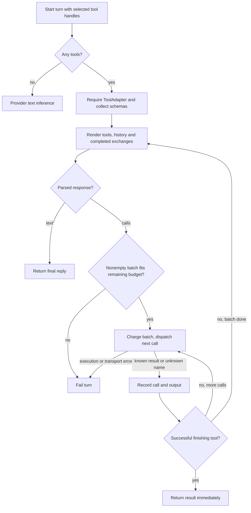

The independent `send` path delegates directly to `Provider::send` for an empty registry. Context-aware chat uses `chat_observed` in that case. When tools are visible, each inference step is buffered and parsed before dispatch. An adapter must return a final reply or a nonempty batch. The dispatcher charges the whole batch against **eight calls per prompt** before executing it sequentially. Each inference step gets its own generation-token budget. An unknown tool name or a returned `ToolOutput::error` can be fed back to the model. An execution `Err`, missing adapter, empty batch, or over-budget batch terminates the turn. [Turn dispatcher and adapter contract](src/provider/tool.rs#L130)

A successful `finishes_turn` tool supplies the reply and skips remaining calls in that batch. A nonempty string passes through, an empty string falls back to the assistant's accompanying content or empty text, and other JSON values are serialized. The recorded exchange contains only calls actually executed. Ordinary chat retains the final prompt/reply pair. A workflow node additionally retains batches, assistant content and reasoning, call IDs, and tool results for later visits. [Tool contract](src/tool.rs) · [Workflow node memory](src/workflow/agent.rs)

The llama.cpp adapter inserts each previous turn's recorded exchanges between its user and final assistant messages. For the current turn it appends exchanges after the new user message. Every assistant call batch is followed by tool-role messages correlated by ID. Recoverable errors carry a `Tool error:` prefix. The template parser returns argument strings which Arta decodes as JSON objects. Missing or empty IDs become zero-padded numbers based on the number of previous calls. A parsed call that exhausts the generation budget is rejected. A recognized stop string clears that exhaustion flag. [llama.cpp tool adapter](src/provider/llama_cpp/tool.rs#L36) · [Prompt construction](#prompt-construction) · [Tool integration test](tests/tool_use.rs)

## Model loading and eviction

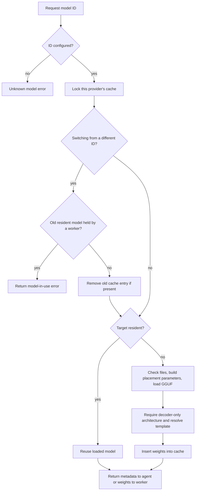

The provider validates context/sampling options, reads any configured template file, and registers unique, nonblank model IDs. An empty registry can exist without initializing a native backend. With models configured, the provider initializes its backend guard, installs a process-wide log callback, and applies NUMA policy when enabled. Profile-specific provider instances share that guard but have their own model registry, cache, chat settings, and inference settings. Diagnostics read a thread-local verbosity flag; fullscreen setup suppresses native verbosity to protect the alternate screen. [Provider construction and cache](src/provider/llama_cpp.rs) · [Backend setup](src/provider/llama_cpp/config.rs) · [Logging scope](src/provider/llama_cpp/logging.rs)

For an explicit shard list, the loader places the primary file first and calls the split-file API. Otherwise it loads from the primary path. It checks regular files, translates device placement and GGUF overrides, and requires a decoder with neither an encoder nor a diffusion architecture. An empty device list forces zero offloaded layers. Positive offload requires a backend that supports it. The wrapper resolves named devices and buffer types and owns the arrays and C strings used by the native loader. [Model loader](src/provider/llama_cpp/model.rs#L38) · [Model parameters](src/provider/llama_cpp/config/model.rs) · [Vendored placement setters](vendor/llama-cpp-4/src/model/params/placement.rs)

An idle agent holds a `ModelInfo` containing ID and trained context length. A worker holds an `Arc` to the resident `LlamaCPPModel`. Eviction checks that the cache owns the last strong reference to those weights. A switch to an unknown ID fails before eviction. A known replacement can fail during loading after the old weights have been removed. The interactive agent updates its selection only on success, so a later prompt can reload its former ID. Closing a session by itself does not evict the provider cache. [Agent switching](src/agent.rs) · [Workflow model selection](#workflow-model-selection)

## Prompt construction

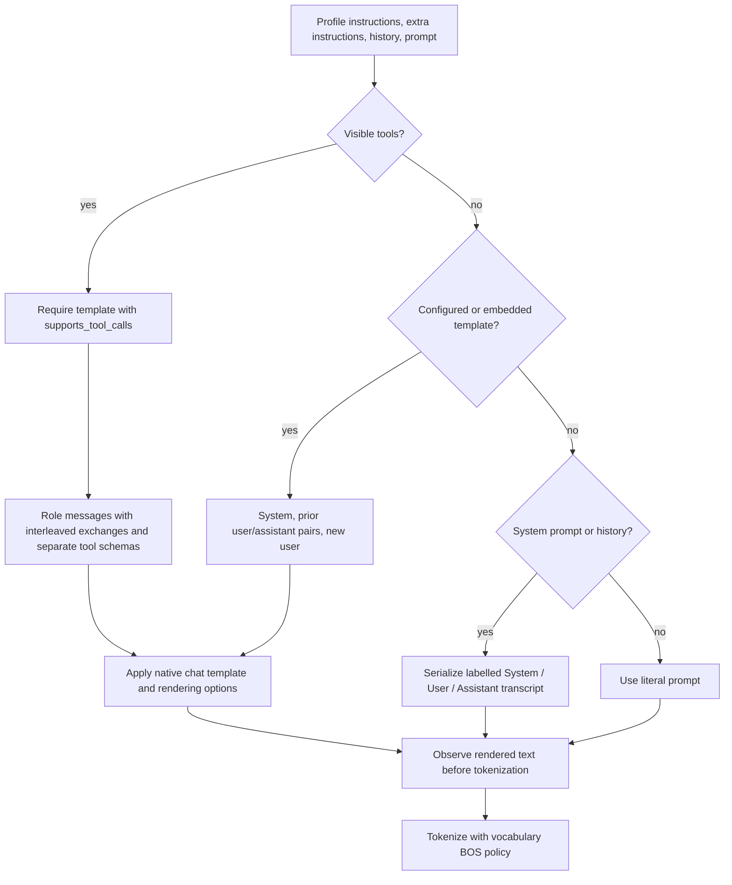

The agent joins base and per-turn instructions with a blank line when both exist. Template selection prioritizes an explicit template (inline, built-in name, or loaded file), then the model's embedded template. A missing or empty embedded template selects plain text; an invalid configured template fails loading. Ordinary template rendering produces prompt text, template-aware tokenization information, and extra stop strings. The native template layer handles compatibility with system roles. Plain text with history ends at an `Assistant:` cue and uses literal tokenization. Both paths honor configured stops. An observer receives the **rendered text** for each observed inference step, before tokenization. [Template selection and plain text](src/provider/llama_cpp/model/template.rs#L61) · [Role message builder](src/provider/llama_cpp/model.rs) · [Chat options](src/provider/llama_cpp/config/chat.rs) · [Tool-specific messages](src/provider/llama_cpp/tool.rs)

## Token generation

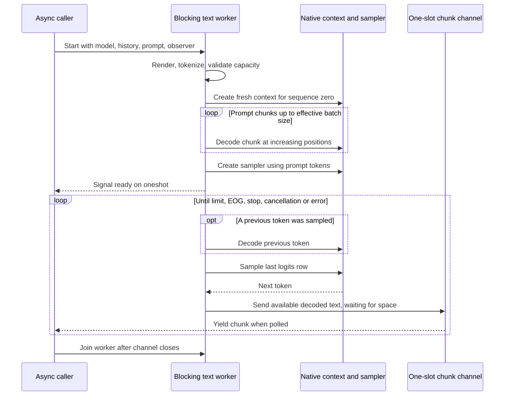

The text path acquires the model and clones the borrowed inputs before starting the worker. Preparation failures reach the caller before it receives a `Message`. Once the worker has decoded the prompt and constructed the sampler, the caller receives a lazy chunk stream. Errors during later decode reach the stream when it joins the worker. A closed channel signals cancellation. Tool steps use the same `generate` function with a cancellation oneshot, collect the full output, and parse it before returning. [Generation and worker lifecycle](src/provider/llama_cpp.rs#L341) · [Tool worker](src/provider/llama_cpp/tool.rs)

Let **P** be the number of prompt tokens after rendering. The requested context is the smaller of 4096 and trained length when omitted, the trained length for configured zero, or the explicit length otherwise. Arta requires it to fit the native signed position range. Usable capacity **C** is the smaller of that request and the new context's reported per-sequence capacity. Inference requires **0 < P < C**. A step can sample at most **min(max_tokens, C − P)** tokens. It requests logits for the last token in each prompt batch. With explicit noncausal attention, prefill also caps batch size at the native microbatch limit. The next step, including one following a tool call, creates a fresh context and tokenizes its entire input again. [Context controls and batch sizing](src/provider/llama_cpp/config/context.rs) · [Token generation](src/provider/llama_cpp.rs)

## Sampling and output boundaries

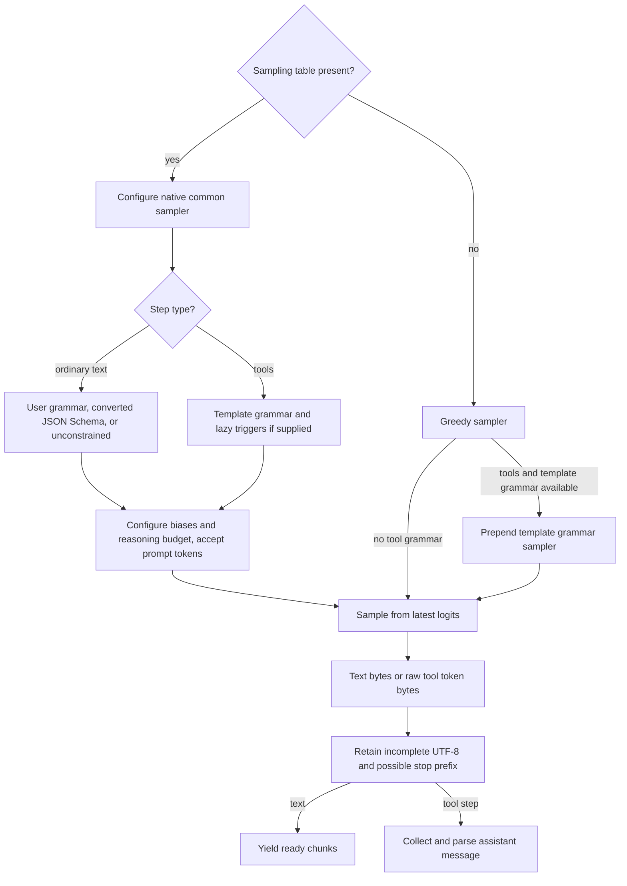

A present sampling table opts into native common-sampler defaults even when empty. It can override stage order, filters, repetition penalties, random seed, and logit biases. A nonnegative reasoning budget requires template-provided opening and closing tags. `ignore_eos` suppresses end-of-generation tokens only on unconstrained steps. Tool steps use template-supplied grammar when present. The configured sampler accepts prompt tokens without advancing grammar, then accepts each generated token with grammar enabled. [Sampling implementation and settings](src/provider/llama_cpp/sampling.rs#L156) · [Configuration examples](config.example.toml)

A token piece need not be valid text on its own. The decoder buffers the longest suffix that could still become a stop string and any incomplete trailing UTF-8 character. A complete stop discards itself and everything following it in that piece. Ordinary exhaustion flushes buffered bytes with lossy UTF-8 conversion. An upstream error terminates with that error. This boundary prevents transient stop prefixes and half-characters from appearing in streaming output. [Byte decoder and boundary tests](src/provider/llama_cpp/text.rs) · [Framed streams](#one-shot-and-framed-streams)

## Workflow definitions and execution

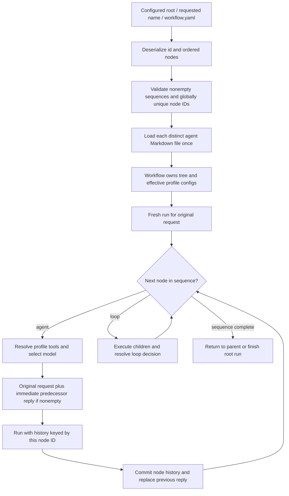

The application defines two node types, `agent` and `loop`. The YAML package defines the actual sequence for each named workflow. The lookup name is a restricted filename component and the YAML `id` is a separate, nonblank display ID. The root and every loop need at least one child. Recursive validation shares one set of node IDs across all depths. Multiple nodes may reference the same Markdown filename. Their configuration is loaded once per profile, while their conversation state remains keyed by **node ID**. The runner checks the request and all referenced providers before entering the first node. Siblings execute in declaration order. [Loader and execution](src/workflow.rs#L80) · [Node schema](src/workflow/node.rs)

The first node sees the original request. On later visits, when the **immediately preceding** reply is nonempty, the prompt is `Workflow request:\n{request}\n\nPrevious node's reply:\n{reply}`. An empty predecessor restores the original request alone. The predecessor can belong to a different profile, a different loop, or a prior iteration. Independently, a revisited node sees its own completed turns and recorded tool exchanges. The executor constructs a temporary `Agent` for the visit, emits output as it drains the reply, then commits the turn only after any required decision succeeds. A new run starts with empty histories, connection cache, loop stack and predecessor. [Per-node conversation](src/workflow/agent.rs#L36) · [Recorded turns](src/provider/tool.rs) · [Worked execution trace](#worked-execution-trace)

## Loop decisions

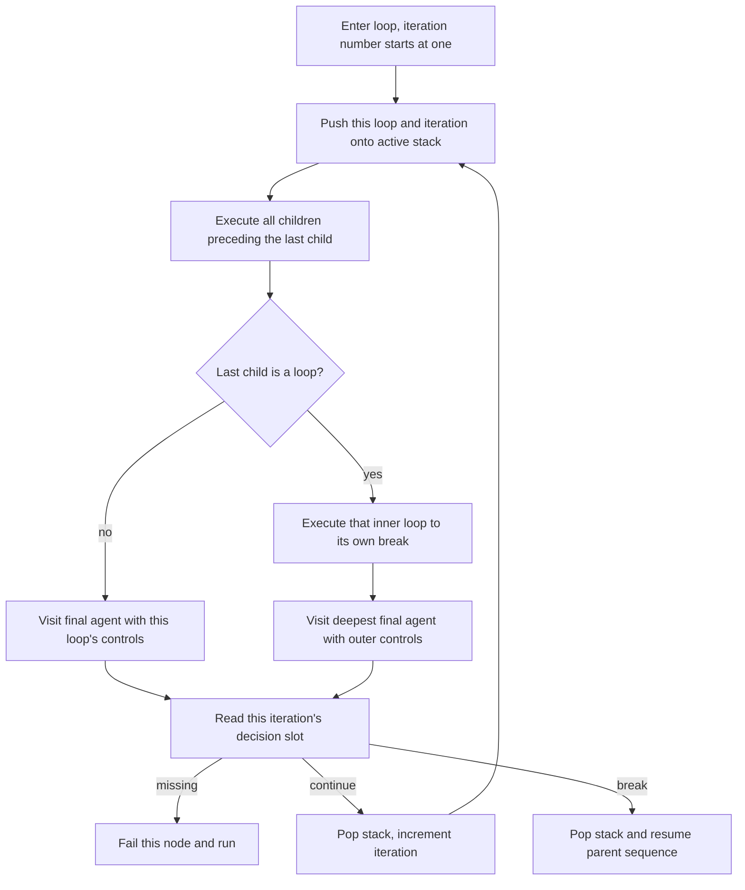

Only the deciding visit gets `continue` and `break`, plus a system instruction naming the current loop. Both tools share a fresh `OnceLock`. They accept only an optional string `message`. An invalid call emits a rejected-call event and returns a recoverable error, so the model can retry within the turn budget. The first valid call sets the decision and finishes the turn. Its message can become the next node's handoff. A prose answer without a valid decision can produce output before the node fails. Subsequent nodes are skipped. There is no iteration-count limit; the eight-call allowance starts anew for each agent turn. [Loop executor and control tools](src/workflow/loop.rs) · [Turn completion rule](src/provider/tool.rs)

For a loop whose last child is itself a loop, the deepest final agent may run twice in succession. First it decides whether the inner loop should exit. After the inner break, the outer executor revisits that same leaf with the **outer** decision slot. It sees its own previous turns and the inner visit's output as the immediate handoff. Each level therefore needs its own decision. [Recursive final-leaf selection](src/workflow/loop.rs#L22) · [Node-scoped state](src/workflow/agent.rs)

## Workflow model selection

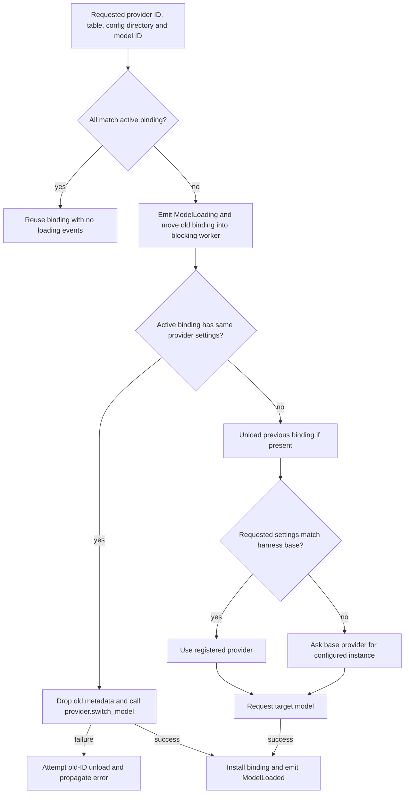

The workflow compares the selected provider's raw TOML table and configuration directory as well as its ID. Two profiles with the same model ID but different settings can legitimately trigger a reload with the same displayed label. Conversely, two nodes sharing a profile and model can keep the same weights while retaining separate histories. When launched from the REPL, the workflow event stream first asks the ordinary agent to unload its model. Its selection and chat history survive, so ordinary chat can reload the model on the next prompt. [Active model binding](src/workflow/model.rs#L59) · [REPL handoff](src/repl.rs#L150) · [Provider cache](#model-loading-and-eviction)

## Workflow events and cleanup

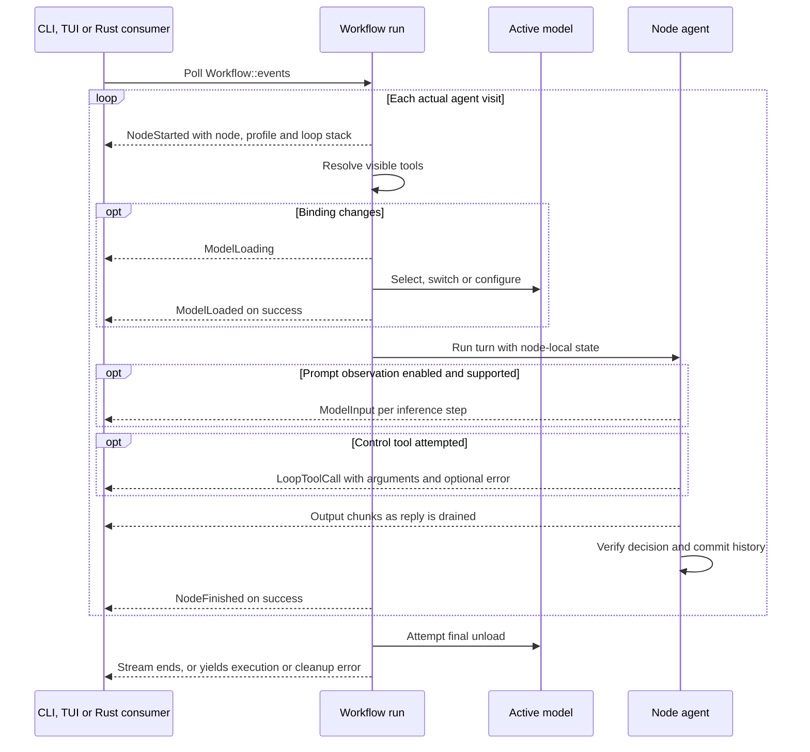

The executor and receiver are polled together with `stream::select`. It starts work as the consumer polls. An unbounded channel carries events, and the ordinary async emitter yields after sending so a reader can flush or draw. The synchronous prompt observer enqueues directly from the provider worker. Tool attempts and new model inputs can interleave over multiple inference steps. `Workflow::run` uses the same interpreter with event emission disabled and returns the final node's text. [Event definitions](src/workflow/event.rs) · [Run and stream implementation](src/workflow.rs#L147)

On normal completion or execution error the runner attempts to unload the final active model on a blocking worker. If execution and cleanup both fail, the execution error takes precedence. Dropping the event stream drops the run future and its per-run state. The active binding has a best-effort drop fallback. Native work already dispatched to a blocking worker can finish or observe cancellation after the caller stops polling. A dropped stream cannot report a subsequent cleanup error. [Resource release](src/workflow/model.rs) · [Generation cancellation](src/provider/llama_cpp.rs) · [Tool worker cancellation](src/provider/llama_cpp/tool.rs)

The CLI writes **every node's** output to stdout. It writes node starts, model loading/switching, and accepted or rejected loop calls to stderr. The TUI also requests model inputs and projects status, node text, and errors into its panes. `NodeFinished` marks success for one visit; stream completion marks the end of a run. [CLI event sink](src/workflow_output.rs) · [TUI event dispatch](src/tui.rs) · [Workflow pane and transcript](src/tui/workflow.rs)

## Worked execution trace

The workflow integration test supplies a real YAML definition and profiles, a local `lookup` tool, and scripted provider replies to the request `Build it`. The two leaves `code` and `rehearse` share the `developer` profile and the `fake/code` model. Each accumulates its own history. Arrows between nodes show the reply that the executor hands to the next visit. [Definition, profiles, scripted requests, and event assertions](tests/workflow.rs#L284)

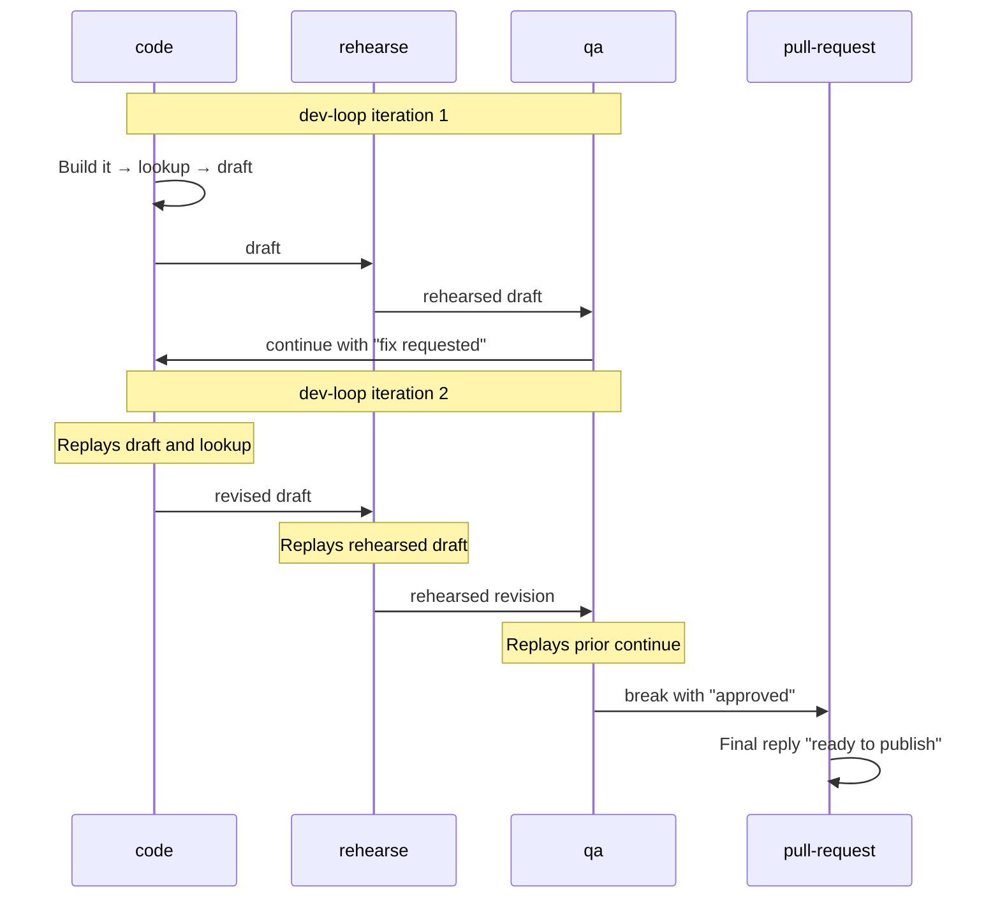

Seven visits yield eight inference inputs because the first `code` visit needs a second inference after `lookup`. The run loads `code → qa → code → qa → publish` and unloads the last model. The test asserts seven node completions, five model-loading events, the two control calls with their arguments and iteration numbers, the seven output strings, and an empty final model slot. A second test makes the deciding agent reply in prose and verifies both run failure and resource release. [Workflow contract tests](tests/workflow.rs) · [Loop decisions](#loop-decisions) · [Reading paths](#reading-paths)

## Native dependency map

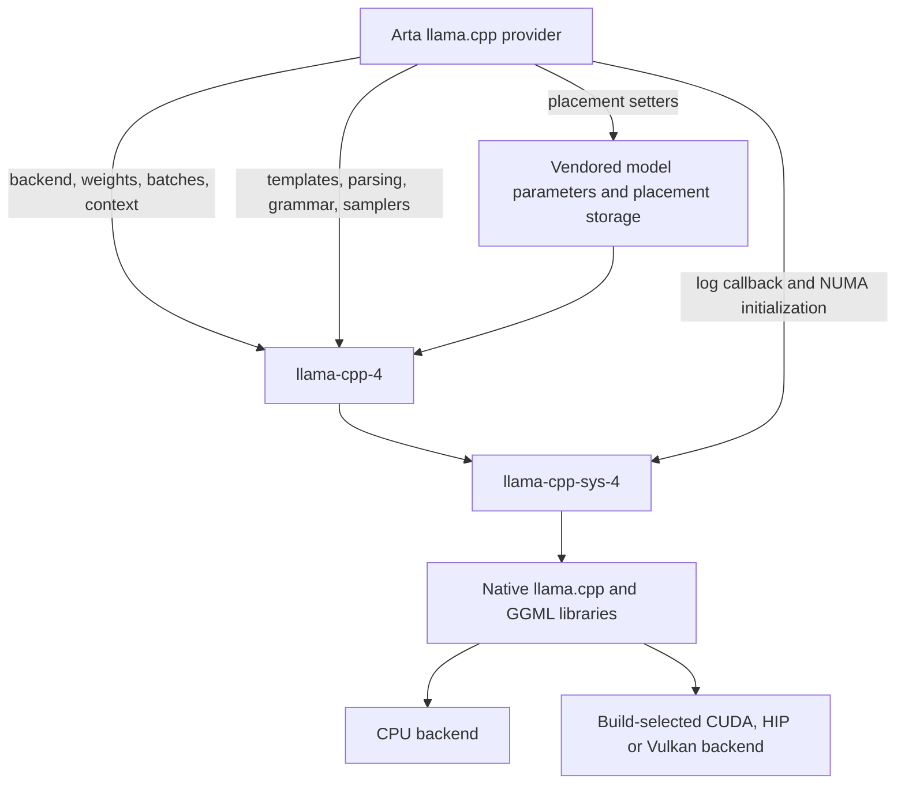

Cargo patches `llama-cpp-4` to the vendored 0.11.0 source and enables its dynamic-link feature. `llama-cpp-sys-4` supplies the native bindings at the locked version. The root crate enables CUDA by default and forwards the optional HIP and Vulkan features. A CPU-only build disables default features. Runtime `devices`, `gpu_layers`, and split settings select placement among available backends. The native shared libraries are part of the executable's runtime environment. [Root manifest](Cargo.toml) · [Locked dependencies](Cargo.lock) · [Vendored manifest](vendor/llama-cpp-4/Cargo.toml) · [Build instructions](README.md#build-and-run-on-windows)

Arta's build script compiles the pinned stable-diffusion.cpp source with its own statically linked GGML and stages the resulting shared library in the active Cargo target profile. It uses the same Cargo backend features as llama.cpp. The image provider loads the staged library on first use and keeps the native model context on its inference thread. [Build script](build.rs) · [CMake source pins](native/stable-diffusion/CMakeLists.txt) · [Image provider](src/provider/stable_diffusion_cpp.rs)

| Boundary | Where to continue |
| --- | --- |
| Initialize backend, resolve placement and load decoder weights | [Backend guard](vendor/llama-cpp-4/src/llama_backend.rs) · [Model and vocabulary](vendor/llama-cpp-4/src/model.rs) · [Model parameters](vendor/llama-cpp-4/src/model/params.rs) · [Placement and pointer lifetimes](vendor/llama-cpp-4/src/model/params/placement.rs) · [Metadata overrides](vendor/llama-cpp-4/src/model/params/kv_overrides.rs) |
| Render a chat, tokenize and parse a response | [Chat templates and parameters](vendor/llama-cpp-4/src/chat.rs) · [Token representation](vendor/llama-cpp-4/src/token.rs) |
| Create a context, prefill batches, and decode | [Context](vendor/llama-cpp-4/src/context.rs) · [Context parameters](vendor/llama-cpp-4/src/context/params/mod.rs) · [Advanced controls](vendor/llama-cpp-4/src/context/params/advanced.rs) · [Batch wrapper](vendor/llama-cpp-4/src/llama_batch.rs) |
| Choose and accept tokens | [Greedy and chained samplers](vendor/llama-cpp-4/src/sampling.rs) · [Common sampler](vendor/llama-cpp-4/src/common_sampler.rs) |
| Follow an FFI call | Arta imports common wrapper types through the prelude. The chat and common APIs share shim error handling at the C boundary. [Prelude](vendor/llama-cpp-4/src/prelude.rs) · [Shim support](vendor/llama-cpp-4/src/shim.rs) · [Common helpers](vendor/llama-cpp-4/src/common.rs) |

The vendored crate includes other workflows for its own callers. Arta uses the decoder-only inference path described above. [Wrapper module index](vendor/llama-cpp-4/src/lib.rs) · [Wrapper overview](vendor/llama-cpp-4/README.md)

| Other wrapper capability | Source |
| --- | --- |
| Prepare model files and estimate placement | [Quantization](vendor/llama-cpp-4/src/quantize.rs) · [Memory fitting](vendor/llama-cpp-4/src/fit.rs) |
| Generate and verify speculative draft tokens | [MTP](vendor/llama-cpp-4/src/mtp.rs) · [EAGLE](vendor/llama-cpp-4/src/eagle.rs) · [N-grams](vendor/llama-cpp-4/src/ngram.rs) |
| Inspect, save, or modify native context state | [Session files](vendor/llama-cpp-4/src/context/session.rs) · [KV cache operations](vendor/llama-cpp-4/src/context/kv_cache.rs) · [Tensor transaction contract](vendor/llama-cpp-4/TENSOR_TRANSACTIONS_SAFETY.md) |
| Enable distributed inference or encode media inputs | [RPC](vendor/llama-cpp-4/src/rpc/mod.rs) · [Multimodal](vendor/llama-cpp-4/src/mtmd.rs) |

## Source and test index

| Component | Primary source | Behavior and collaborators |
| --- | --- | --- |
| Crate roots and startup | [Library exports](src/lib.rs) · [Binary](src/main.rs) · [Config](src/config.rs) · [Agent profiles](src/config/agent.rs) · [Front matter](src/front_matter.rs) | [Startup and configuration](#startup-and-configuration) |
| Runtime and streaming API | [Harness](src/harness.rs) · [Session](src/session.rs) · [Agent](src/agent.rs) · [Model](src/model.rs) · [Frames and messages](src/stream.rs) | [Runtime ownership](#runtime-ownership) · [One-shot and framed streams](#one-shot-and-framed-streams) |
| Provider and tool interfaces | [Provider](src/provider.rs) · [Factory registry](src/provider/registry.rs) · [Adapter and dispatch](src/provider/tool.rs) · [Tools](src/tool.rs) · [MCP](src/mcp.rs) · [Skills](src/skill.rs) | [Tool discovery and visibility](#tool-discovery-and-visibility) · [Tool inference and dispatch](#tool-inference-and-dispatch) |
| llama.cpp model and inference | [Provider and generation](src/provider/llama_cpp.rs) · [Loaded model](src/provider/llama_cpp/model.rs) · [Templates](src/provider/llama_cpp/model/template.rs) · [Sampling](src/provider/llama_cpp/sampling.rs) · [Byte decoding](src/provider/llama_cpp/text.rs) · [Tool adapter](src/provider/llama_cpp/tool.rs) · [Logging](src/provider/llama_cpp/logging.rs) | [Model loading](#model-loading-and-eviction) · [Prompt construction](#prompt-construction) · [Token generation](#token-generation) |
| Provider settings | [Provider defaults and CLI overrides](src/provider/llama_cpp/config.rs) · [Model load settings](src/provider/llama_cpp/config/model.rs) · [Context settings](src/provider/llama_cpp/config/context.rs) · [Chat settings](src/provider/llama_cpp/config/chat.rs) · [Example TOML](config.example.toml) | [Sampling and output boundaries](#sampling-and-output-boundaries) · [Native dependency map](#native-dependency-map) |
| Conversation input | [REPL](src/repl.rs) · [Parser](src/repl/parser.rs) · [Suggestions](src/repl/suggestion.rs) · [MCP visibility](src/repl/mcp.rs) · [Skill selection](src/repl/skill.rs) | [Conversation commands and mentions](#conversation-commands-and-mentions) |
| Slash commands | [Registration](src/repl/command.rs) · [Exit](src/repl/command/exit.rs) · [Reset](src/repl/command/reset.rs) · [Model](src/repl/command/model.rs) · [Workflow](src/repl/command/workflow.rs) | [Submission order](#conversation-commands-and-mentions) |
| Terminal presentation | [TUI and editor](src/tui.rs) · [Workflow views](src/tui/workflow.rs) · [Markdown](src/markdown.rs) · [Workflow output](src/workflow_output.rs) | [Terminal interfaces](#terminal-interfaces) · [Event lifecycle](#workflow-events-and-cleanup) |
| Workflow runtime | [Loader and runner](src/workflow.rs) · [Node tree](src/workflow/node.rs) · [Per-node state](src/workflow/agent.rs) · [Loop controls](src/workflow/loop.rs) · [Active model](src/workflow/model.rs) · [Progress](src/workflow/event.rs) | [Workflow definitions](#workflow-definitions-and-execution) · [Model selection](#workflow-model-selection) · [Worked trace](#worked-execution-trace) |

| Executable specification | What it exercises |
| --- | --- |
| [CLI](tests/cli.rs) | Launches the binary and checks argument errors, implicit interactive setup, blank stdin before model loading, and missing files. |
| [Config and registry](tests/config_registry.rs) | Checks factory discovery, duplicate and unknown IDs, selection overrides, retained runtime settings and removal of obsolete shards. |
| [Sessions and streaming](tests/model_selection.rs) | Uses controlled providers to check bindings, validation before session publication, frame ordering, polling, cancellation, and independent streams. |
| [Tool use](tests/tool_use.rs) | Sends a turn through a bound agent, executes an in-process function, and checks the follow-up seen by the adapter. |
| [Workflows](tests/workflow.rs) | Drives real definition loading with a scripted provider to check history, tool replay, loop decisions, event order, switches, and final unload. |

Unit tests alongside the implementation cover narrower boundaries, including [parser rule ordering](src/repl/parser.rs), [mention persistence and reset](src/repl.rs), [rendered panes and input editing](src/tui.rs), [stop strings and UTF-8](src/provider/llama_cpp/text.rs), and [skill package discovery](src/skill.rs) using a [Markdown fixture](tests/fixtures/skills/review-notes/SKILL.md). To browse the library's types and private helpers locally, generate Rustdoc with `cargo doc --locked --no-deps --document-private-items`. [Return to reading paths](#reading-paths)
